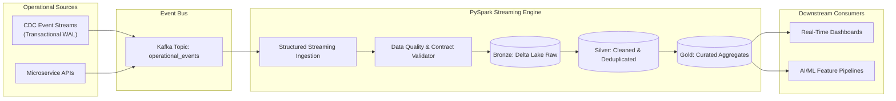

# Real-Time Data Streaming & Lakehouse Platform

[](https://opensource.org/licenses/MIT)
[](https://www.python.org/downloads/)
[](https://kafka.apache.org/)
[](https://spark.apache.org/)
[](https://delta.io/)
[](https://databricks.com/)

> **High-throughput enterprise streaming platform leveraging Apache Kafka, PySpark Structured Streaming, and Databricks Delta Lake with CDC ingestion patterns, ACID transactions, automated data quality validation, and Airflow orchestration.**

---

## 🏗️ Architecture & Data Ingestion Flow



---

## 🚀 Key Technical Features

* **CDC Pattern Ingestion**: Seamlessly consumes write-ahead change logs from operational databases into Kafka topics.
* **Medallion Lakehouse Architecture**: Bronze (raw append-only), Silver (schema enforcement & deduplicated records), and Gold (pre-computed dimensional aggregations).
* **Fault-Tolerant Checkpointing**: End-to-end exactly-once processing semantics backed by Delta Lake transaction logs.
* **Automated Data Quality Validation**: In-stream schema drift detection, null constraint validation, and quarantine routing.
* **Databricks Workflows & Airflow Orchestration**: Scheduled optimization jobs (`OPTIMIZE` + `ZORDER`) maintaining sub-second query performance.

---

## 📂 Project Structure

```
realtime-lakehouse-streaming-platform/
├── ci/
│   └── ci.yml                 # CI testing pipeline
├── dags/
│   └── lakehouse_maintenance_dag.py # Airflow Delta compaction DAG
├── docs/
│   └── architecture.md        # Technical architectural specification
├── sample_data/
│   └── events.json            # Mock operational events
├── src/
│   ├── __init__.py
│   ├── cdc_producer.py        # Mock CDC transactional producer
│   ├── data_quality.py        # In-stream data contract validator
│   ├── schema.py              # Event StructType schema definitions
│   └── streaming_pipeline.py  # PySpark Structured Streaming engine
├── tests/
│   └── test_streaming.py      # Unit tests
├── docker-compose.yml         # Local Kafka & Zookeeper environment
├── requirements.txt           # Dependencies
└── .gitignore
```

---

## ⚡ Quickstart

```bash
git clone https://github.com/masonmirtech/realtime-lakehouse-streaming-platform.git
cd realtime-lakehouse-streaming-platform
python -m venv venv
.\venv\Scripts\activate
pip install -r requirements.txt
pytest tests/ -v
```

---

## 📜 License
MIT License.
