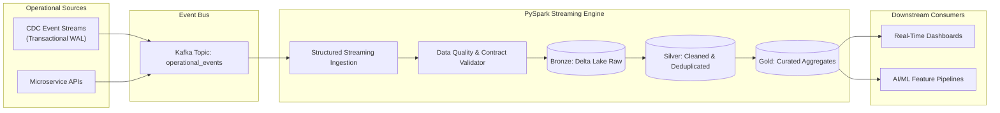

# Real-Time Data Streaming & Lakehouse Platform

[](https://opensource.org/licenses/MIT)
[](https://www.python.org/downloads/)
[](https://kafka.apache.org/)
[](https://spark.apache.org/)
[](https://delta.io/)
[](https://databricks.com/)

> **High-throughput enterprise streaming platform leveraging Apache Kafka, PySpark Structured Streaming, and Databricks Delta Lake with CDC ingestion patterns, ACID transactions, automated data quality validation, and Airflow orchestration.**

---

## 🏗️ Architecture & Data Ingestion Flow



---

## 🚀 Key Technical Features

* **CDC Pattern Ingestion**: Seamlessly consumes write-ahead change logs from operational databases into Kafka topics.
* **Medallion Lakehouse Architecture**: Bronze (raw append-only), Silver (schema enforcement & deduplicated records), and Gold (pre-computed dimensional aggregations).
* **Fault-Tolerant Checkpointing**: End-to-end exactly-once processing semantics backed by Delta Lake transaction logs.
* **Automated Data Quality Validation**: In-stream schema drift detection, null constraint validation, and quarantine routing.
* **Databricks Workflows & Airflow Orchestration**: Scheduled optimization jobs (`OPTIMIZE` + `ZORDER`) maintaining sub-second query performance.

---

## 📂 Project Structure

```
realtime-lakehouse-streaming-platform/
├── ci/
│   └── ci.yml                 # CI testing pipeline
├── dags/
│   └── lakehouse_maintenance_dag.py # Airflow Delta compaction DAG
├── docs/
│   └── architecture.md        # Technical architectural specification
├── sample_data/
│   └── events.json            # Mock operational events
├── src/
│   ├── __init__.py
│   ├── cdc_producer.py        # Mock CDC transactional producer
│   ├── data_quality.py        # In-stream data contract validator
│   ├── schema.py              # Event StructType schema definitions
│   └── streaming_pipeline.py  # PySpark Structured Streaming engine
├── tests/
│   └── test_streaming.py      # Unit tests
├── docker-compose.yml         # Local Kafka & Zookeeper environment
├── requirements.txt           # Dependencies
└── .gitignore
```

---

## ⚡ Quickstart

```bash
git clone https://github.com/devmasonmir/realtime-lakehouse-streaming-platform.git
cd realtime-lakehouse-streaming-platform
python -m venv venv
.\venv\Scripts\activate
pip install -r requirements.txt
pytest tests/ -v
```

---

## Local batch validation

`process_event_batch` accepts a list of decoded JSON values and returns
`(valid_events, quarantined)`. Each quarantine entry is `(original_value, errors)`.
Non-object records (including `null`, arrays, strings, numbers, and booleans) are
quarantined with `Event must be a JSON object`, so later valid records still run.
The helper preserves input records and their order within each output group.
The first valid occurrence of an `event_id` is accepted; later valid records
with the same ID in that batch are quarantined as duplicates. An invalid record
does not reserve its ID, so a later valid record can still be accepted.
Object checks require non-null required fields and a JSON object payload.
`event_id`, `event_type`, and `source_system` must be non-blank strings.
`timestamp_ms` must be a non-negative integer (not a boolean, float, or numeric
string). Optional `is_deleted` must be a boolean when present. Extra fields are
preserved; payload contents and event type names are not restricted. This helper
does not write quarantine records to storage.

### Offline command-line demo

From the repository root, validate the supplied synthetic sample with Python
3.10+ and the standard library only (no dependency installation required):

```bash
python -m src.validate_events sample_data/events.json
```

The command reads a UTF-8 JSON array and prints a JSON report with `valid_events`
and `quarantined` arrays to stdout. Each quarantine entry contains the original
`event` and its `errors`. Logs and input errors go to stderr, so stdout can be
redirected to a report file. Input files are never modified. Exit codes are `0`
for an entirely valid batch (including an empty array), `1` when any records are
quarantined, and `2` for unreadable files, malformed JSON, non-array input, or
non-finite JSON constants (`NaN`/`Infinity`) or floating-point overflow.
Invalid input produces no report.
Use synthetic data: the report includes the original record contents. This is
an offline contract-validation demo, not a Kafka/Spark or Delta Lake integration
test; it loads the whole array into memory. Duplicate detection is limited to
one call and does not maintain state across files or streaming micro-batches.

Run the batch-isolation and contract regression tests without Kafka, Spark, or
extra packages:

```bash
python -m unittest discover -s tests -p test_batch_validation.py -v
python -m unittest discover -s tests -p test_event_contract.py -v
python -m unittest discover -s tests -p test_validation_cli.py -v
```

## 📜 License
MIT License.
